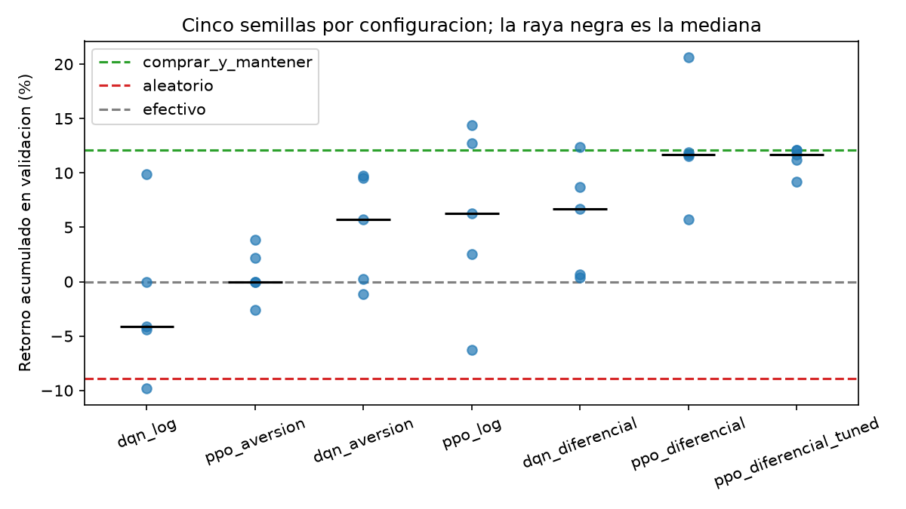
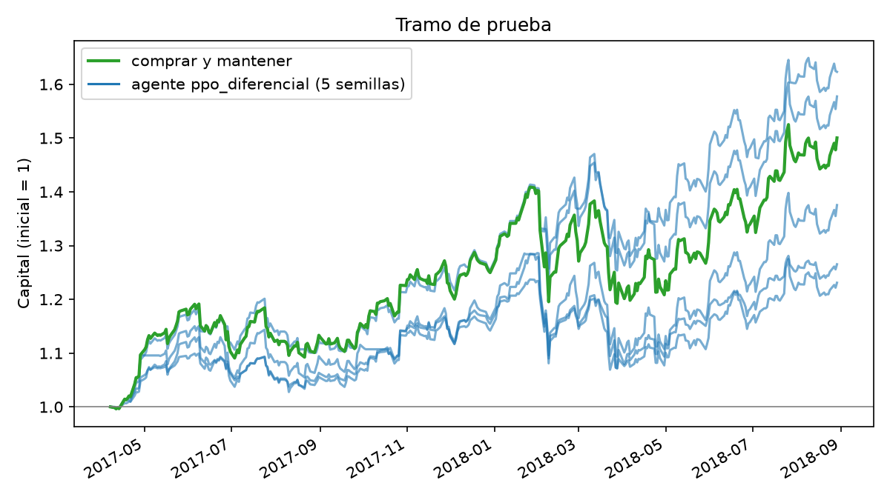

# Agente Inversor

[](https://github.com/glizano/agente_inversor/actions/workflows/ci.yml)
[](LICENSE)

Proyecto final de Simulación y Aprendizaje por Refuerzo (EFMIA-SAPR20265), Maestría en
Inteligencia Artificial, Universidad de La Sabana.

Autores: Leonar Socarrás Molina (leonarsomo@unisabana.edu.co), John Jairo Serrano Cifuentes (johnseci@unisabana.edu.co), Brezhnev Joya Miranda (brezhnevjomi@unisabana.edu.co), Gabriel Alonso Lizano Alvarado (gabriellial@unisabana.edu.co), Bryan Johann Aranzazu Medina (bryanarme@unisabana.edu.co). Docente: Emilio Muñoz Pérez.

## Resumen

Formulamos la inversión en una sola acción (GOOGL, cierre diario) como un proceso de
decisión: cada día el agente observa siete indicadores y decide tener invertido el 0 %, el
50 % o el 100 % del capital, pagando 0,1 % por el capital que mueve. Comparamos tres
funciones de recompensa y dos algoritmos (DQN y PPO, de Stable-Baselines3), con cinco
semillas cada combinación, y elegimos la configuración solo con el tramo de validación.

En el tramo de prueba, usado una única vez, el agente elegido (PPO con recompensa
diferencial) obtuvo una mediana de +37,5 % entre sus cinco semillas, frente a +50,0 % de
comprar y mantener y +4,4 % del agente aleatorio. **No supera a comprar y mantener**: dos
de las cinco semillas lo hacen y tres no. La máxima caída mediana fue 13,8 %, contra 15,4 %
de comprar y mantener. La sección 6 discute por qué creemos que ese es el resultado
esperable y qué limita lo que se puede concluir.

El proyecto parte de la base sugerida en clase,
[`rl_games_sb`](https://github.com/emiliomunozai/rl_games_sb): misma organización (CLI,
configuraciones en YAML, registro de algoritmos), seguimiento con MLflow y búsqueda de
hiperparámetros con Optuna. Lo propio del proyecto es el entorno, las recompensas, el
protocolo de evaluación y los baselines.

## Cómo reproducir

```bash
uv sync
uv run pytest -q                      # 10 pruebas del entorno y las métricas

uv run agente-inversor inspeccionar   # datos, tramos, estado, acciones
uv run agente-inversor baselines --tramo validacion

scripts/comparar.sh 2                 # 30 corridas (2 en paralelo), cerca de 30 min en CPU
uv run agente-inversor tune    --config configs/ppo.yaml --recompensa diferencial
uv run agente-inversor entrenar --config configs/ppo_tuned.yaml --sufijo _tuned
uv run agente-inversor resumen        # tabla de validación

uv run agente-inversor prueba  --config configs/ppo.yaml --recompensa diferencial
uv run python scripts/graficar.py

uv run mlflow ui                      # http://127.0.0.1:5000, experimento agente_inversor
```

Las semillas están fijas en los YAML (0 a 4) y los modelos entrenados están en `saves/`,
así que `prueba` reproduce la tabla final sin reentrenar. Al reentrenar en otra máquina los
números pueden variar levemente por diferencias de versión de PyTorch.

## 1. Formulación del problema

**Datos.** Cierre diario de GOOGL del 22 de mayo de 2009 al 29 de agosto de 2018 (2.335
días hábiles), el conjunto que trae `gym-anytrading`, la librería de entornos de inversión
incluida en la base del curso.

**Estado**, siete números, todos calculados con los últimos 20 días:

| # | Indicador | Por qué |
|---|---|---|
| 1 | Último retorno, en unidades de volatilidad | Lo más reciente que pasó |
| 2 | Momento a 5 días | Tendencia de corto plazo |
| 3 | Momento a 20 días | Tendencia de la ventana |
| 4 | Media de 5 días contra media de 20 | Cruce de medias, la señal técnica más común |
| 5 | Volatilidad anualizada | Nivel de riesgo actual |
| 6 | Distancia al máximo de la ventana | Si el precio viene de una caída |
| 7 | Exposición actual (0, 0,5 o 1) | Ver abajo |

Los indicadores 1 a 4 y 6 se dividen por la volatilidad de la propia ventana. Así quedan en
una escala parecida sin usar ninguna estadística global de la serie, que sería una forma de
mirar el futuro. La exposición actual hace que el problema sea markoviano: el costo de la
próxima acción depende de dónde está el capital hoy.

**Acciones**, `Discrete(3)`: tener invertido el 0 %, el 50 % o el 100 % del capital. La
acción es la exposición objetivo, no una orden de compra o venta, de modo que repetir la
acción no opera ni cuesta.

**Dinámica.** El día *t* el agente ve hasta el cierre de *t*, decide, y cobra el retorno
de *t* a *t*+1. El final de los datos se marca como truncamiento y no como estado terminal,
porque invertir no "termina" ahí.

## 2. Entorno

`src/agente_inversor/envs.py`, compatible con Gymnasium.

- **Costo.** `|exposición nueva − actual| × 0,001`. Pasar de 0 % a 100 % cuesta el doble
  que pasar de 0 % a 50 %.
- **Sin información del futuro.** Una prueba cambia todos los precios posteriores a *t* y
  verifica que el estado en *t* no cambia (`test_el_estado_no_usa_precios_futuros`).
- **Contabilidad.** Otra prueba verifica que comprar y mantener reproduce exactamente el
  retorno del activo menos el costo de entrada.
- **Entrenamiento con ventanas aleatorias.** Cada episodio de entrenamiento es un año
  bursátil (252 días) que empieza en un día al azar del tramo de entrenamiento. En el primer
  borrador del proyecto el agente recorría siempre la misma serie de principio a fin y la
  memorizaba (+292 % en entrenamiento, −22 % en validación, con datos sintéticos). Las
  ventanas aleatorias son la medida que tomamos contra eso.

**Partición cronológica**, 70 / 15 / 15:

| Tramo | Fechas | Días | Comprar y mantener |
|---|---|---|---|
| Entrenamiento | 2009-06-23 a 2015-11-16 | 1.613 | +267,7 % |
| Validación | 2015-11-17 a 2017-04-07 | 350 | +12,1 % |
| Prueba | 2017-04-10 a 2018-08-29 | 351 | +50,0 % |

Ningún retorno se cobra en dos tramos (`test_los_tramos_no_comparten_retornos`).

## 3. Diseño de la recompensa

Probamos tres recompensas. En todas, *r* es el retorno logarítmico diario de la cartera ya
neto del costo, en puntos porcentuales.

| Nombre | Definición | Qué esperábamos |
|---|---|---|
| `log` | *r* | Maximizar el crecimiento del capital. Es aditiva en el tiempo |
| `diferencial` | *r* menos el retorno del activo | Premiar solo lo que se gana **respecto a** comprar y mantener. Estar 100 % invertido vale 0 |
| `aversion` | *r* si es ganancia, 2*r* si es pérdida | Un agente más prudente, con menos caídas |

Resultados en validación, mediana de cinco semillas por configuración (las métricas se
calculan siempre sobre el capital real, nunca sobre la recompensa):

| Configuración | Retorno entrenamiento | Retorno validación (mín. a máx.) | Máx. caída | Exposición media | Operaciones |
|---|---|---|---|---|---|
| PPO, `diferencial` | +285,6 % | **+11,7 %** (+5,7 a +20,6) | 14,2 % | 0,80 | 56 |
| DQN, `diferencial` | +448,5 % | +6,7 % (+0,4 a +12,4) | 14,6 % | 0,76 | 97 |
| PPO, `log` | +177,4 % | +6,3 % (−6,3 a +14,4) | 13,3 % | 0,78 | 61 |
| DQN, `aversion` | +122,5 % | +5,7 % (−1,1 a +9,7) | 3,3 % | 0,05 | 23 |
| PPO, `aversion` | +12,6 % | 0,0 % (−2,6 a +3,9) | 0,5 % | 0,01 | 2 |
| DQN, `log` | +670,2 % | −4,1 % (−9,8 a +9,9) | 12,9 % | 0,48 | 100 |
| *Comprar y mantener* | *+267,7 %* | *+12,1 %* | *14,2 %* | *1,00* | *1* |
| *Agente aleatorio* | | *−8,9 %* | *16,3 %* | *0,50* | *234* |



**Comportamiento que induce cada recompensa:**

- **`aversion` enseña a no invertir.** Con pérdidas que pesan el doble, el valor esperado
  de estar en el mercado es negativo aunque el activo suba, y el agente aprende a quedarse
  en efectivo (exposición 0,01 con PPO). Cumple lo que se le pidió, casi no tiene caídas,
  pero renuncia al retorno. Es un caso de *reward hacking*: optimiza la recompensa sin hacer
  lo que queríamos, que era invertir con prudencia.
- **`log` con DQN memoriza.** Es la configuración con mejor retorno en entrenamiento
  (+670 %) y la peor en validación (−4,1 %), con 100 operaciones en 350 días. Aprendió
  cuándo entrar y salir en la serie de entrenamiento, y esas reglas no se sostienen fuera.
- **`diferencial` da el mejor resultado y la menor dispersión con PPO.** Como estar
  invertido vale 0, el agente solo se aparta de comprar y mantener cuando cree tener una
  razón. Dos de las cinco semillas convergen a estar casi siempre invertidas (5 o 6
  operaciones); las otras tres operan activamente.
- **PPO generaliza mejor que DQN** con la misma recompensa en `log` y `diferencial`. La
  brecha entre entrenamiento y validación es menor.

Ninguna configuración supera a comprar y mantener en la mediana de validación.

## 4. Protocolo de evaluación

Definido antes de mirar el tramo de prueba:

1. **Entrenamiento:** 2 algoritmos × 3 recompensas × 5 semillas, 100.000 pasos cada corrida.
2. **Selección en validación:** la configuración con mayor mediana de retorno entre sus
   cinco semillas. Resultado: PPO con `diferencial`.
3. **Hiperparámetros con Optuna**, también sobre validación: 15 pruebas, cada una con dos
   semillas de 50.000 pasos. Regla fijada de antemano: los hiperparámetros encontrados se
   adoptan solo si, al reentrenar las cinco semillas completas, la mediana en validación
   mejora.
4. **Prueba:** una sola evaluación de la configuración elegida, con sus cinco semillas,
   contra los baselines. Nada se ajusta después.

**Resultado del paso 3.** Optuna reportó una mejor mediana de +15,3 %. Al reentrenar con
cinco semillas completas la mediana fue +11,65 %, idéntica a la de los hiperparámetros
originales, y tres de las cinco semillas convergieron a comprar y mantener. No hubo mejora,
así que conservamos los hiperparámetros originales. El +15,3 % era en parte suerte de dos
semillas: elegir el máximo entre 15 pruebas ruidosas sobreestima.

Los baselines son comprar y mantener, 50 % fijo, quedarse en efectivo, y un agente
aleatorio (promedio de 100 semillas).

## 5. Resultados en el tramo de prueba

| | Retorno | Máx. caída | Sharpe | Exposición media | Operaciones |
|---|---|---|---|---|---|
| Agente, semilla 0 | +26,5 % | 13,4 % | 1,08 | 0,64 | 48 |
| Agente, semilla 1 | +23,1 % | 16,8 % | 0,87 | 0,75 | 45 |
| Agente, semilla 2 | +62,3 % | 12,9 % | 1,80 | 0,87 | 52 |
| Agente, semilla 3 | +37,5 % | 15,0 % | 1,08 | 0,92 | 9 |
| Agente, semilla 4 | +57,7 % | 13,8 % | 1,57 | 1,00 | 3 |
| **Agente, mediana** | **+37,5 %** | **13,8 %** | **1,08** | | |
| Comprar y mantener | +50,0 % | 15,4 % | 1,36 | 1,00 | 1 |
| 50 % fijo | +23,5 % | 7,8 % | 1,42 | 0,50 | 1 |
| En efectivo | 0,0 % | 0,0 % | | 0,00 | 0 |
| Agente aleatorio | +4,4 % ± 11,3 | 15,5 % | 0,20 | 0,50 | 234 |



- El agente supera con claridad al agente aleatorio en las cinco semillas.
- No supera a comprar y mantener: mediana +37,5 % contra +50,0 %, y dos de cinco semillas
  por encima.
- La semilla con peor retorno (+23,1 %) queda apenas por debajo de tener el 50 % fijo
  (+23,5 %), con el doble de caída.
- La dispersión entre semillas (de +23 % a +62 %) es mayor que la diferencia entre el
  agente y comprar y mantener. Con una sola semilla habríamos podido reportar tanto "le
  gana por 12 puntos" como "pierde por 27".

## 6. Discusión

**El resultado es el esperable.** En un tramo en que la acción sube 50 %, cada día fuera
del mercado cuesta retorno. Las semillas que más se parecen a comprar y mantener son las
que mejor quedan, y la semilla 4 supera a comprar y mantener con solo 3 operaciones, lo
cual es compatible con haber evitado uno o dos días malos por azar.

**Limitaciones.**

- **Un solo activo y un solo periodo.** GOOGL de 2009 a 2018 es casi todo mercado alcista.
  El agente nunca vio una caída prolongada, así que no sabemos cómo se comportaría en una.
- **No estacionariedad.** Los tramos son distintos entre sí (+12 % en validación, +50 % en
  prueba, en periodos de igual duración). La configuración elegida en validación no tiene
  por qué ser la mejor en prueba, y lo que el agente aprendió de 2009 a 2015 puede no
  aplicar después.
- **Validación pequeña y reutilizada.** Con 350 días elegimos entre seis configuraciones y
  luego entre quince conjuntos de hiperparámetros. Lo que pasó con Optuna muestra que esa
  selección ya estaba ajustándose al ruido.
- **Costos simplificados.** Un 0,1 % fijo, sin diferencial de compra y venta, sin
  deslizamiento y sin impuestos. Las semillas que operan unas 50 veces serían las más
  afectadas por costos reales.
- **Indicadores solo de precio.** Si el precio diario ya incorpora la información pública,
  hay poca señal que extraer de él.
- **Cinco semillas** alcanzan para ver que la dispersión es grande, no para estimar bien
  una diferencia de medianas.

**Reward hacking.** El caso claro es `aversion` (sección 3). `diferencial` tiene uno más
sutil: la política que no hace nada (100 % invertido siempre) recibe recompensa 0, que es
un óptimo local cómodo, y varias semillas terminan ahí.

**Qué haríamos después.** Entrenar con varios activos para que el agente vea más regímenes;
evaluar con ventanas móviles (*walk-forward*) en lugar de un solo corte; y agregar
indicadores que no sean solo del precio.

## 7. Reflexión

*(Pendiente: reflexión del equipo sobre el proceso.)*

## 8. Estructura

```
configs/                 # un YAML por algoritmo: entorno, hiperparámetros, búsqueda
scripts/comparar.sh      # la rejilla completa de corridas
scripts/graficar.py      # figuras del informe
src/agente_inversor/
├── cli.py               # argumentos y formato de salida
├── datos.py             # precios y partición cronológica
├── envs.py              # entorno de inversión y recompensas
├── evaluacion.py        # simulación, métricas y baselines
├── experiments.py       # entrenamiento, Optuna y evaluación final
├── registry.py          # algoritmos de Stable-Baselines3 y rutas de modelos
├── config.py            # lectura de los YAML
└── tracking.py          # registro en MLflow
resultados/              # tablas, figuras y una ficha JSON por corrida
saves/                   # modelos entrenados, uno por configuración y semilla
tests/                   # pruebas del entorno y de las métricas
```

## 9. Uso de inteligencia artificial

El código, los experimentos y la redacción de este informe se desarrollaron con la
asistencia de Claude (Anthropic). Las decisiones de formulación, el protocolo de evaluación
y la interpretación de los resultados fueron revisados por el equipo.

## 10. Referencias

- Muñoz, E. (2026). *rl_games_sb* [Software]. https://github.com/emiliomunozai/rl_games_sb
- Raffin, A., Hill, A., Gleave, A., Kanervisto, A., Ernestus, M., & Dormann, N. (2021).
  Stable-Baselines3: Reliable reinforcement learning implementations. *Journal of Machine
  Learning Research, 22*(268), 1-8.
- Schulman, J., Wolski, F., Dhariwal, P., Radford, A., & Klimov, O. (2017). Proximal policy
  optimization algorithms. *arXiv:1707.06347*.
- Mnih, V., et al. (2015). Human-level control through deep reinforcement learning.
  *Nature, 518*, 529-533.
- Akiba, T., Sano, S., Yanase, T., Ohta, T., & Koyama, M. (2019). Optuna: A next-generation
  hyperparameter optimization framework. *KDD '19*.
- Sutton, R. S., & Barto, A. G. (2018). *Reinforcement learning: An introduction* (2.ª ed.).
  MIT Press.
- Haghpanah, A. (s. f.). *gym-anytrading* [Software]. https://github.com/AminHP/gym-anytrading

## 11. Licencia

Apache 2.0 (ver `LICENSE`)
